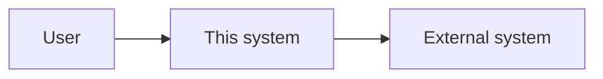

# Architecture

## Style and why
Advisor output (traits: BatchDataFeeds, ReadHeavy, ExternalPartnerIntegrations, RegulatoryAudit, SmallTeam):

### Recommendation: CleanArchitecture

One business area with rules that must be tested without the database or UI. Keep the domain at the centre.

#### Patterns
- **AuditTrail**: Keep an immutable record of who did what and when; regulators and clients will ask.
- **CachedReadModel**: Serve searches from a separate, cached read side so reads never slow down writes.
- **AdapterPerPartner**: Each outside system gets its own adapter behind an interface, so its quirks stay out of your domain.
- **SeparateIngestionPipeline**: Each feed gets its own scheduled, re-runnable job that lands raw data first, then cleans it; a bad file never corrupts the warehouse.

#### Closest reference systems
- Reporting warehouse fed by many sources (similarity 0.80): One re-runnable import job per source into a single warehouse, and a plain read-only reporting app on top.
- Clinic or hospital patient system (similarity 0.29): Clean Architecture or modular monolith, with a full audit history.
- Document extraction with human review (similarity 0.29): Clean Architecture API plus a worker fed by a queue; fields the model is unsure about wait for a person.

#### Risks to watch

#### Evolve when
- A second business area appears with its own language: make it a module of a modular monolith.
- Search becomes the bottleneck: move it to a dedicated search service.

Record the final choice with write_adr, including what you rejected.

Judgement: Build one re-runnable import job per layout into a single warehouse, with a plain read-only dashboard on top. See `decisions/0001-architecture-style.md`.

## Context

## Modules and boundaries
TODO: each module, what it owns, what it may call.

## Cross-cutting
TODO: auth, logging, tracing, configuration, error handling.