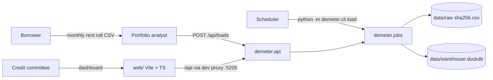

# Architecture

## Style and why
Advisor output (traits: BatchDataFeeds, ReadHeavy, ExternalPartnerIntegrations, RegulatoryAudit, SmallTeam):

### Recommendation: CleanArchitecture

One business area with rules that must be tested without the database or UI. Keep the domain at the centre.

#### Patterns
- **AuditTrail**: Keep an immutable record of who did what and when; regulators and clients will ask.
- **CachedReadModel**: Serve searches from a separate, cached read side so reads never slow down writes.
- **AdapterPerPartner**: Each outside system gets its own adapter behind an interface, so its quirks stay out of your domain.
- **SeparateIngestionPipeline**: Each feed gets its own scheduled, re-runnable job that lands raw data first, then cleans it; a bad file never corrupts the warehouse.

#### Closest reference systems
- Reporting warehouse fed by many sources (similarity 0.80): One re-runnable import job per source into a single warehouse, and a plain read-only reporting app on top.
- Clinic or hospital patient system (similarity 0.29): Clean Architecture or modular monolith, with a full audit history.
- Document extraction with human review (similarity 0.29): Clean Architecture API plus a worker fed by a queue; fields the model is unsure about wait for a person.

#### Risks to watch

#### Evolve when
- A second business area appears with its own language: make it a module of a modular monolith.
- Search becomes the bottleneck: move it to a dedicated search service.

Record the final choice with write_adr, including what you rejected.

Judgement: Build one re-runnable import job per layout into a single warehouse, with a plain read-only dashboard on top. See `decisions/0001-architecture-style.md`.

Stack: Python 3.12, pydantic contracts, FastAPI + uvicorn, DuckDB (one file under `data/`), Vite + vanilla TypeScript dashboard. See `decisions/0002-python-duckdb-stack.md`. Reconcile/reject policy: `decisions/0003-reconcile-and-reject-policy.md`. Full dossier: `docs/DESIGN.md`.

## Context

## Modules and boundaries
Medallion layers inside one Clean Architecture deployable (`src/demeter/`):

| Module | Owns | May call |
|---|---|---|
| `contracts/` | one pydantic row model + `Layout` per borrower layout (`keelridge`, `marlowe`, `tidewater`), `CanonicalRow`, detection | nothing |
| `ingest/` | raw landing: bytes stored unchanged as `data/raw/<sha256>.csv` (read-only) | filesystem |
| `reconcile/` | sum of every data row vs the file's total row, in the file's own unit; unit count | `contracts` |
| `clean/` | contract + shared rules per row; rejects with line and reason | `contracts` |
| `model/` | DuckDB schema and writes: `raw_files`, `job_runs`, `quarantine_files`, `quarantine_rows`, `dim_borrower`, `dim_property`, `fact_unit_rent`; portfolio query | `contracts`, `clean`, `ingest` types |
| `lineage/` | figure -> file, line, job run, raw line | `model`, `ingest` |
| `jobs.py` | the load workflow, job-run bookkeeping | all above |
| `api/` | FastAPI endpoints, problem+json, health | `jobs`, `lineage`, `model` |
| `cli.py` | scheduled/manual loads | `jobs` |

`tests/test_boundaries.py` fails if an inner module imports DuckDB, FastAPI or an outer module.

## Cross-cutting
- **Auth:** none in slice 1 (local, invented data). Next: SSO at a reverse proxy, roles analyst/committee.
- **Logging:** one structured log line per job run (read, written, rejected, ms, status); the `job_runs` table is the durable record.
- **Configuration:** env vars `RENTROLL_DATA_DIR`, `RENTROLL_MAX_UPLOAD_BYTES` (`.env.example`).
- **Errors:** RFC 7807 problem+json; a quarantined file is `422` with the reason and the job run; unexpected errors close the job run as `failed`.
- **Time and money:** UTC timestamps (injectable clock), `Decimal` / `DECIMAL(18,2)`, money as strings in JSON.
- **Idempotency:** content checksum for raw files; natural-key upsert `(borrower_id, property_code, unit_ref, as_of_date)` for facts.
