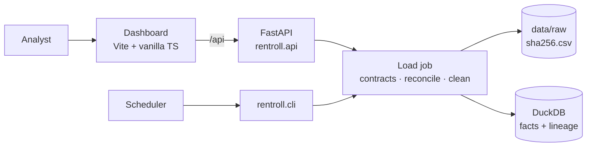

# Rent Roll Pipeline

A data pipeline for Harbourline Lending (fictional), a property lender: it loads borrowers' monthly rent rolls in many layouts, reconciles each file to its own stated total, and feeds a portfolio dashboard where every figure traces back to the exact line of the original file. All names and numbers are invented.

## Design at a glance
**Brief.** About 40 borrowers send rent rolls in a dozen layouts, so the portfolio view is rebuilt by hand every month and rarely reconciles first time. The goal: portfolio refreshed within an hour of a file arriving, totals reconciled automatically, files kept unchanged and bad files quarantined, never half-loaded.

**Architecture.** A Clean Architecture monolith shaped as a medallion pipeline: raw (files stored byte-for-byte under their SHA-256), clean (one pydantic contract per borrower layout, rejects quarantined with a reason) and model (DuckDB facts and dimensions, upserted on natural keys, each row carrying source file, line and job run id). One re-runnable load job per file, a FastAPI read API and a plain dashboard on top. It's batch data (monthly files, about 20k rows a month), read daily, with strict audit needs and a one-engineer team. That means one process and one file-based warehouse, not serverless functions or a streaming platform. The project uses Python + DuckDB, unlike the rest of the portfolio (.NET), because the work is CSV contracts and set-based SQL that the analyst can read too (ADR-0002). It moves to Postgres when a second writer process appears. Full reasoning, the options table, diagrams and capacity numbers: [`docs/DESIGN.md`](docs/DESIGN.md).



## What it does today (slice 1)
- Three invented borrower layouts with their own column names, date formats, units and total rows (`samples/`), each with a data contract in `src/rentroll/contracts/`.
- Upload or CLI load: land raw unchanged with a checksum, detect the layout, reconcile rows to the file's total (mismatch: `422`, file quarantined with the difference, nothing loaded), validate rows (bad rows quarantined with line and reason), upsert facts in one transaction.
- Re-runnable: the same file twice gives no duplicates; a corrected file replaces that borrower's month. Every job run records rows read, written and rejected, duration and status.
- Portfolio: occupancy and contracted monthly rent per property, data freshness, files in quarantine.
- Lineage: every property figure lists its units with source file, line, job run id and the raw line.
- Dashboard: KPI strip, property table, upload panel, lineage drill-down, job-run history with rejected counts; loading, empty, error and success states; light and dark.

## Run locally
```bash
pip install -r requirements.lock
PYTHONPATH=src uvicorn rentroll.api.app:app --port 5205     # API (OpenAPI at /docs)
cd web && npm ci && npm run dev                              # dashboard on http://localhost:5285
pytest                                                       # 42 tests
```
Smoke test, CLI and incidents: `.agentic/runbook.md`.

## How this project is organised
- `src/rentroll/`: `contracts/`, `ingest/`, `clean/`, `reconcile/`, `model/`, `lineage/`, `api/`, `jobs.py`, `cli.py`.
- `tests/`: contract, rule, pipeline, API and boundary tests (pytest).
- `samples/`: invented rent rolls, rebuilt by `tools/make_samples.py` (one is broken on purpose).
- `web/`: Vite + vanilla TypeScript dashboard with Vitest tests.
- `docs/DESIGN.md`: design dossier. `.agentic/`: project knowledge (start with `.agentic/README.md`). AI agents read `AGENTS.md` first.

Built with the Baton model from the Agentic Engineering Kit: frame → map → decide → sketch → slice loop → pass the baton.
