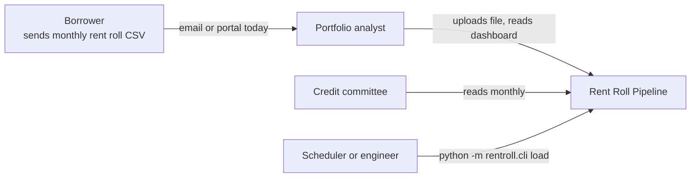
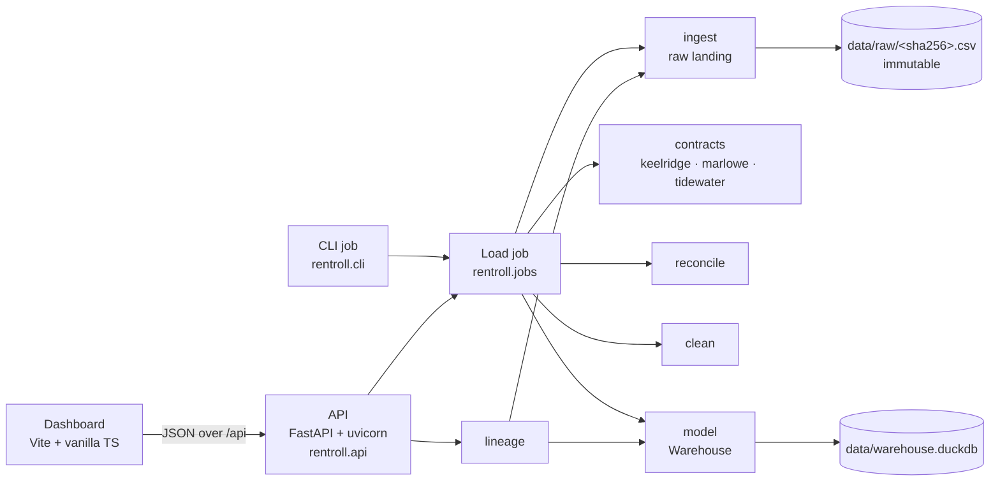
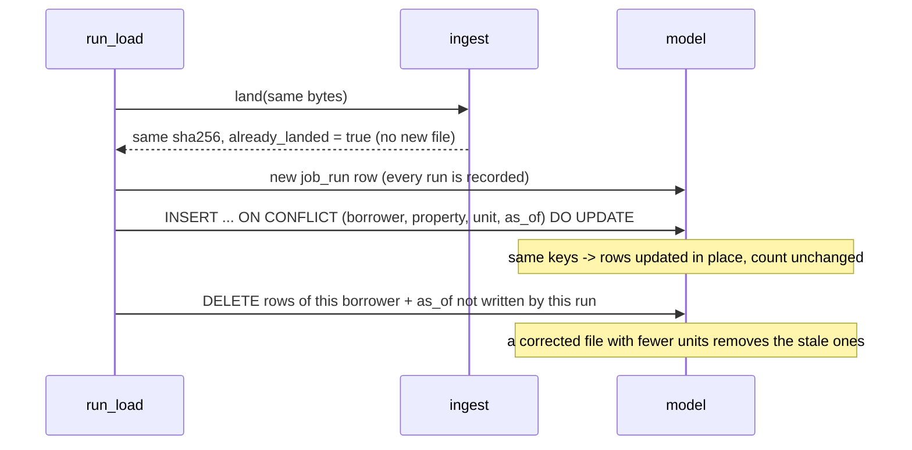
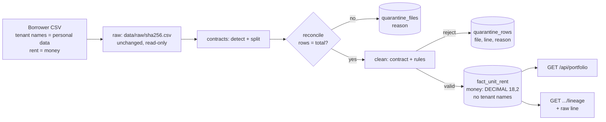
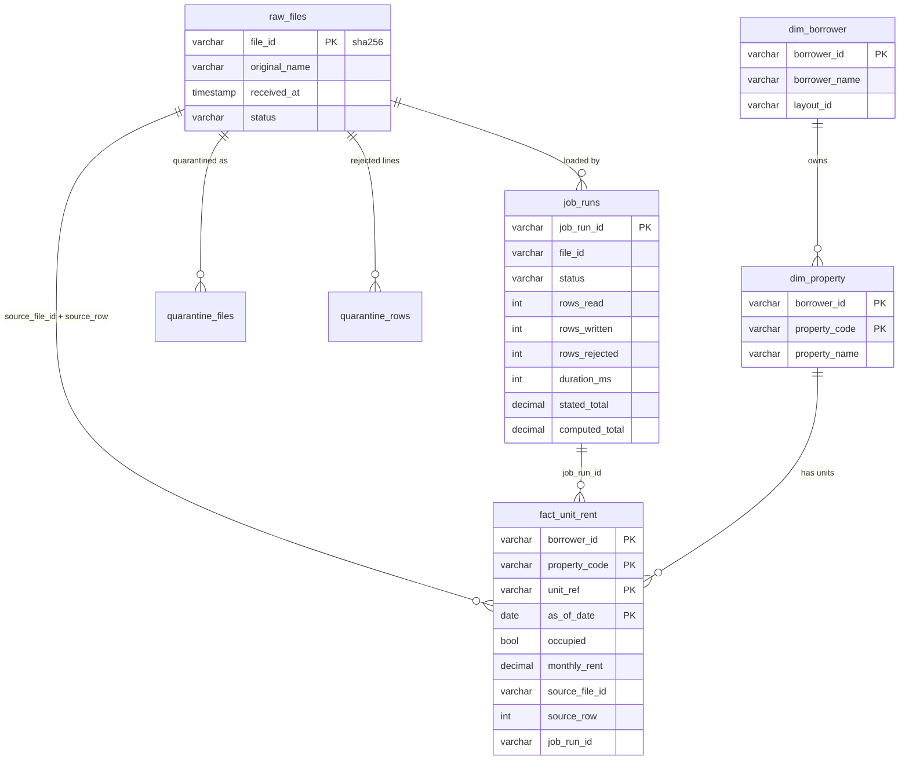

# Rent Roll Pipeline design dossier

> Harbourline Lending is a fictional lender. Every borrower, property, tenant and amount here is invented. Amounts are in rand (R).

Read time: about 15 minutes. Code is the source of truth; every diagram names real modules, endpoints and tables.

## 1. Brief
- **Client:** Harbourline Lending, a property lender with about 40 borrowers.
- **Problem:** borrowers send rent rolls in a dozen layouts, so the portfolio view is rebuilt by hand every month and rarely reconciles first time.
- **Users:** portfolio analysts (daily), credit committee (monthly).
- **Outcomes:** portfolio view refreshed within an hour of files arriving; totals reconcile automatically; every reported figure traces to its source file.
- **Constraints:** files kept unchanged; bad files quarantined, never half-loaded.

## 2. Requirements
**Functional (slice 1, `.agentic/backlog.md`)**
1. An analyst drops one borrower's rent roll and sees occupancy and rent per property, reconciled to the file total.
2. Loading the same file twice leaves no duplicates.
3. A file whose total doesn't match its rows fails and is quarantined with a reason.
4. Any dashboard figure can be traced to its source file and row.

**Non-functional**
| Quality | Target | Source |
|---|---|---|
| Freshness | portfolio refreshed < 1 h after a file arrives (today: < 1 s after upload) | product.md outcome |
| Correctness | 100% of loaded files reconcile to their stated total; mismatches never reach the model | product.md constraint |
| Traceability | 100% of fact rows carry `source_file_id`, `source_row`, `job_run_id` | RegulatoryAudit trait |
| API availability | 99.9% over 30 days (internal tool, business hours matter most) | quality.md |
| p95 latency | < 300 ms for portfolio and lineage reads | quality.md |
| Retention | raw files and job runs kept 7 years (assumed lender audit rule) | assumption |
| Privacy | tenant names stay in the raw file only; the model holds no tenant names | design choice (POPIA minimisation) |

## 3. Capacity estimate
Assumptions: 40 borrowers, one rent roll each per month, up to 500 units per roll (median ~60), ~80 bytes per CSV line.

| Quantity | Sum | Result |
|---|---|---|
| Rows per month | 40 x 500 (worst case) | 20,000 |
| Rows per year | 20,000 x 12 | 240,000 fact rows |
| Raw storage per year | 240,000 x 80 B | ~20 MB (round to 50 MB with re-sends) |
| Warehouse per year | ~3x raw for indexes and history | ~150 MB |
| Load time per file | measured ~25 ms for 8 rows; row-wise upsert ~1 ms/row | 500 rows < 1 s |
| Peak load burst | month-end: 40 files in a morning | < 1 min of work in total |
| Dashboard reads | 5 analysts x 50 views/day + committee | < 500 req/day, peak < 1 req/s |

One machine handles this about a thousand times over. The binding constraint is correctness and audit, not scale.

## 4. Options considered
`arch-advisor compare BatchDataFeeds ReadHeavy ExternalPartnerIntegrations RegulatoryAudit SmallTeam`:

| Option | Fit | Complexity (1-5) | Main reason |
|---|---|---|---|
| Clean Architecture monolith | Recommended | 2 | Matches the advisor's recommended style (CleanArchitecture). |
| Layered monolith | Possible | 1 | Batch feeds: scheduled, re-runnable import jobs fit well here. |
| Vertical slice monolith | Possible | 2 | Small team: low enough operational load to run comfortably. |
| Modular monolith | Possible | 3 | Small team: low enough operational load to run comfortably. |
| Modular monolith + CQRS read models | Possible | 3 | Read-heavy: separate read models keep queries fast. |
| Serverless functions + queues | Possible | 3 | Batch feeds: scheduled, re-runnable import jobs fit well here. |
| Event-sourced core with CQRS | Possible | 4 | Audit: the event log is the audit trail, with replay for free. |
| Static site + serverless function | Poor fit | 1 | The product has real server-side behaviour and data; a static site can't hold it. |
| Microservices (request/response) | Poor fit | 5 | A small team can't run a distributed system well (deployments, tracing, on-call). |
| Event-driven microservices | Poor fit | 5 | A small team can't run a distributed system well (deployments, tracing, on-call). |

- **Chosen: Clean Architecture monolith shaped as a medallion pipeline** (ADR-0001). Layout contracts and reconciliation rules sit at the centre with no database or web imports (enforced by `tests/test_boundaries.py`); DuckDB and FastAPI are adapters. One business area, one engineer: one deployable.
- **Layered monolith:** close second and cheaper, but it lets parsing rules leak into SQL and endpoints; the per-borrower adapters (AdapterPerPartner) need a cleaner seam.
- **Modular monolith (+ CQRS):** only one business area today. The portfolio query already acts as a read model over the fact table; a separate store would add a sync job for < 1 req/s.
- **Serverless functions + queues:** fits bursty imports, but 40 files a month don't need scale-to-zero, and splitting land, reconcile and load across functions makes the one-transaction "never half-loaded" rule and end-to-end testing harder. Cold starts and execution limits buy nothing here.
- **Streaming / event-driven:** rent rolls arrive monthly as whole files with a total row; reconciliation needs the whole file. There is no stream to process.
- **Event sourcing:** the audit need is met more simply: raw files are immutable and checksummed, every job run is recorded, every fact row points to its file line.
- **Microservices:** a one-engineer team cannot run them well.
- **Global-scale answer:** not applicable; the product has no global-scale traits. Growth means more borrowers, not more regions.
- **Evolution trigger (ADR-0001/0002):** a second business area (for example, covenant monitoring on operating statements) becomes a module; a second writer process or hosted multi-user access moves the warehouse from DuckDB to Postgres.

**Why Python and DuckDB here (ADR-0002), when the rest of the portfolio is .NET:** the work is CSV parsing, typed per-layout contracts and set-based SQL over a few hundred thousand rows. Pydantic models make each borrower's contract readable by the analyst; DuckDB gives a real SQL warehouse (transactions, `ON CONFLICT` upserts, analytic queries) in one file with no server. For a one-engineer team that is the smallest stack that still meets the audit rules.

## 5. Architecture
### C4 context


### C4 container


### Modules and contracts
| Module | Owns | May call | Contract it exposes |
|---|---|---|---|
| `contracts` | one pydantic row model + `Layout` per borrower layout; `CanonicalRow`; layout detection | nothing outside itself | `resolve(text, layout_id)`, `Layout.split()`, `Layout.to_canonical()` |
| `ingest` | raw landing: byte-for-byte storage named by SHA-256, read-only | filesystem | `land()`, `read_raw_line()` |
| `reconcile` | file total vs rows, in the file's own unit | `contracts` | `reconcile(parsed, layout) -> ReconcileResult` |
| `clean` | row validation, duplicates, as-of consistency, reject reasons | `contracts` | `clean(parsed, layout) -> CleanResult` |
| `model` | DuckDB schema: `raw_files`, `job_runs`, `quarantine_*`, `dim_*`, `fact_unit_rent`; upserts; read queries | `contracts`, `clean`, `ingest` types | `Warehouse` |
| `lineage` | tracing a figure to file, line, job run and raw text | `model`, `ingest` | `property_lineage()` |
| `jobs` | the load workflow and job-run bookkeeping | all of the above | `run_load()` |
| `api` | HTTP: problem+json errors, money as strings, health | `jobs`, `lineage`, `model` | endpoints below |

Endpoints: `POST /api/loads`, `GET /api/job-runs`, `GET /api/job-runs/{id}`, `GET /api/portfolio`, `GET /api/properties/{borrower_id}/{property_code}/lineage`, `GET /api/quarantine`, `GET /api/layouts`, `GET /health/live`, `GET /health/ready`.

## 6. Communication flows
### Slice 1: load a rent roll (all synchronous, one process)
```mermaid
sequenceDiagram
  actor A as Analyst
  participant W as Dashboard
  participant API as rentroll.api
  participant J as jobs.run_load
  participant I as ingest
  participant C as contracts / reconcile / clean
  participant M as model (DuckDB)
  A->>W: choose file
  W->>API: POST /api/loads (multipart)
  API->>J: run_load(bytes, name)
  J->>I: land(bytes) -> sha256, data/raw/<sha>.csv
  J->>M: register_raw_file, start_job_run (status running)
  J->>C: resolve layout, split, reconcile
  alt total matches
    J->>C: clean -> rows + rejects
    J->>M: BEGIN; upsert dims + facts; delete leftovers; quarantine_rows; finish_job_run; COMMIT
    API-->>W: 201 job run (read, written, rejected)
  else mismatch / no total / unknown layout
    J->>M: quarantine_files + finish_job_run (quarantined)
    API-->>W: 422 problem+json (reason, job_run)
  end
  W->>API: GET /api/portfolio, GET /api/job-runs
```

### Riskiest flow: the same or a corrected file arrives again

The natural key is the idempotency key: no client-supplied key is needed because the content itself (checksum) and the business key (borrower, property, unit, month) make retries safe. There is no outbox: nothing is published to other systems in slice 1.

## 7. Data flow

Money is `Decimal` in Python, `DECIMAL(18,2)` in DuckDB and a string in JSON; the web formats the string without converting to float. Annual rent (Tidewater layout) is reconciled in annual terms first, then converted to monthly with half-up rounding.

## 8. Data model

All tables belong to the `model` module. Consistency is strong: one DuckDB transaction per load, so the portfolio read either sees a whole file or none of it. Event time (`as_of_date`) and load time (`loaded_at`, `received_at`) are stored separately; the dashboard reports by event time and shows load time as freshness.

## 9. Scaling path (what breaks first, in order)
1. **More layouts (40+ borrowers):** each is ~60 lines of contract plus a sample-file test. When layouts become config-like, move simple ones to a declarative mapping (column names, date format, total marker) and keep code only for odd ones.
2. **Concurrent writers / hosted multi-user:** DuckDB allows one writer process. Move to Postgres (same SQL, `ON CONFLICT` works) and run loads in a worker fed by a queue or schedule; the API becomes read-only.
3. **Row-wise upserts get slow (> ~50k rows per file):** stage the clean rows into a temp table and do one set-based `INSERT ... SELECT ... ON CONFLICT`.
4. **Dashboard queries slow down (years of history):** materialise a `portfolio_latest` read model at the end of each load.
5. **Files arrive by email/SFTP:** add an inbox watcher that calls the same `run_load`; nothing else changes.

## 10. Failure modes
| Failure | Effect | Mitigation |
|---|---|---|
| Total row doesn't match rows | Load would be wrong | Reconcile before load; job fails, file quarantined with the difference; model untouched (tested) |
| Same file uploaded twice | Duplicate rent | Checksum lands it once; natural-key upsert; job run recorded twice (tested) |
| Corrected file for same month | Stale units linger | Delete rows of the borrower/month not written by this run, same transaction (tested) |
| Unknown or new layout | Can't parse | Quarantined: "no single known layout matches"; add a contract |
| Invalid row (blank suite, bad date) | Partial data | Row quarantined with line + reason; counted in job run and shown on the dashboard (ADR-0003) |
| Crash mid-load | Half-loaded file | One transaction; rollback on any error; job run closed as `failed` |
| Disk full / DuckDB file locked | Loads fail, reads fail | `/health/ready` returns 503; raw file can be replayed after the fix |
| Non-UTF-8 or oversized upload | Garbage parse | Quarantined as "not UTF-8"; 413 above 5 MB |
| Two loads at once | Write conflict | In-process lock serialises loads; single uvicorn worker by design until Postgres |

## 11. Security and privacy
- **AuthN/AuthZ:** none in slice 1 (local, invented data). Before real data: put the app behind the lender's SSO (OIDC) at a reverse proxy; roles `analyst` (upload + read) and `committee` (read). Logged in user goes on the job run.
- **Data protection (POPIA):** tenant names (possibly natural persons) are kept only in the immutable raw file; the model stores units, rent and dates. The lineage endpoint returns the raw line, so it must sit behind the same authorisation as the files.
- **Input handling:** uploads are size-capped, decoded strictly as UTF-8, parsed by the csv module (no eval, no spreadsheet formulas). All SQL uses bound parameters; table names in `count()` come from an allow-list. Rendered file content is HTML-escaped in the dashboard (tested).
- **Secrets:** none needed. Raw files are written read-only (`0444`). CI runs gitleaks and the privacy guard.

## 12. Observability
- **Job runs table** is the primary telemetry: rows read, written, rejected, duration, status, message for every run (also logged as one structured line per run).
- **SLIs/SLOs** (`.agentic/quality.md`): freshness (file received -> loaded) < 1 h for 99% of files; reconciliation pass rate tracked per borrower; API p95 < 300 ms; availability 99.9%.
- **Alert that wakes someone (business hours):** a borrower's file quarantined and not replaced within 2 working days at month-end, or any job run with status `failed` (a bug, not a data problem).
- **Next:** OpenTelemetry traces around `run_load` stages; export job-run counts as metrics.

## 13. Testing strategy
| Layer | Here | Files |
|---|---|---|
| Contracts | each layout on its sample file: detect, split, totals, mapping quirks (day-first dates, annual rent, inverted flags) | `tests/test_contracts.py` |
| Rules | reconcile and clean rules on tiny hand-made files | `tests/test_rules.py` |
| Seams | full job against a real DuckDB file in a temp dir | `tests/test_pipeline.py` |
| API | FastAPI TestClient, problem+json, money as strings | `tests/test_api.py` |
| Boundaries | inner modules never import DuckDB, FastAPI or outer modules | `tests/test_boundaries.py` |
| Web | formatters and render functions (escaping, states, status chips) | `web/src/*.test.ts` |
| Smoke | uvicorn on :5205, curl uploads, portfolio and lineage | `.agentic/runbook.md` |

Acceptance criteria to tests:
| Criterion | Tests |
|---|---|
| AC1 loaded twice, no duplicates | `test_ac1_loading_the_same_file_twice_creates_no_duplicates`, `test_ac1_rejected_rows_are_not_duplicated_on_reload`, `test_ac1_upload_twice_over_http_keeps_portfolio_unchanged` |
| AC2 mismatch fails and quarantines with a reason | `test_ac2_total_mismatch_fails_the_load_and_quarantines_the_file`, `test_ac2_quarantined_file_is_kept_unchanged_with_its_checksum`, `test_ac2_bad_file_does_not_disturb_already_loaded_data`, `test_ac2_mismatched_total_returns_422_problem_with_reason_and_job_run` |
| AC3 figure traces to file and row | `test_ac3_every_unit_behind_a_property_figure_traces_to_file_row_and_job_run`, `test_ac3_lineage_endpoint_returns_source_file_row_and_raw_line` |
| Dashboard numbers equal the model | `test_portfolio_figures_equal_the_model_tables` |

## 14. Interview questions
1. **What if the same file is uploaded twice?** It lands once (same SHA-256), a second job run is recorded, and the upsert on (borrower, property, unit, as-of) updates rows in place. The fact count is unchanged; a test proves it.
2. **Why reconcile all rows, including invalid ones?** Reconciliation proves we read everything the borrower sent. Validity is a separate question answered per row. Reconciling only valid rows would fail every file that has one blank cell and hide which problem actually happened (ADR-0003).
3. **How does an auditor trace a number?** Portfolio row -> lineage endpoint -> each unit's `source_file_id` (checksum), `source_row` and `job_run_id`, plus the exact line read back from the unchanged raw file. The sum of the lineage rows equals the figure (tested).
4. **Why DuckDB and not Postgres?** 240k rows a year, one writer, one engineer. DuckDB is a real SQL engine with transactions in a file. The trigger to move is a second writer process or hosted multi-user access; the SQL ports as is.
5. **Why not serverless or streaming?** Files arrive monthly and must be reconciled whole; there's no stream. Serverless would split one transaction across functions and add cold starts for 40 files a month.
6. **A borrower changes their layout. What happens?** The header signature no longer matches, so the file is quarantined with "no single known layout matches". You add or version a contract with its sample file and contract test, then replay the raw file. Nothing bad reaches the model.
7. **How would you handle 4,000 borrowers?** Declarative mappings for simple layouts, Postgres, a queue-fed worker, set-based staging upserts, and a materialised portfolio read model. The contracts and reconciliation rules stay as they are.
8. **How do you keep money exact?** Decimal end to end: parsed from text, `DECIMAL(18,2)` in storage, string in JSON, formatted from the string in the browser. Annual-to-monthly conversion rounds half-up once, after reconciliation.
9. **What stops a half-loaded file?** Reconcile before writing, then one transaction for dims, facts, leftovers delete, row rejects and the job-run status. Any exception rolls back and closes the run as `failed`.
